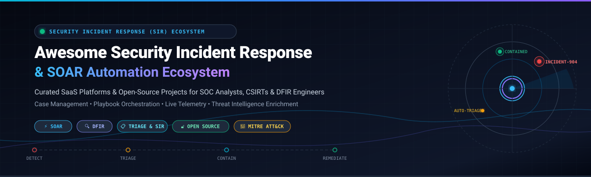
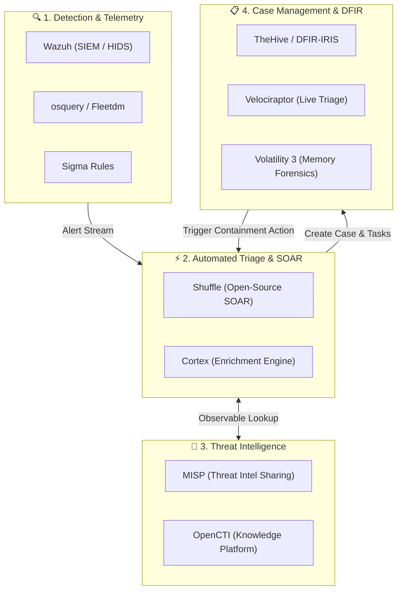

  

  
  
  
  
  
  
  

---

# 🛡️ Awesome Security Incident Response (SIR) & SOAR Ecosystem

> ⚡ **A curated directory of top-tier SaaS platforms and sovereign open-source projects for Security Incident Response (SIR), Security Orchestration, Automation, and Response (SOAR), and Digital Forensics (DFIR).**

Welcome to the definitive guide for **Security Incident Response (SIR)** solutions. Modern Security Operations Centers (SOCs), Computer Security Incident Response Teams (CSIRTs), and DFIR practitioners rely on these technologies to triage alerts, orchestrate automated containment playbooks, manage forensic cases, and accelerate threat remediation across cloud, hybrid, and endpoint infrastructures.

---

## 📑 Table of Contents

- [📊 Sector Overview & Market Dynamics](#-sector-overview--market-dynamics)
- [🏢 SaaS & Enterprise SIR Platforms](#-saas--enterprise-sir-platforms)
- [🔓 Open-Source Incident Response Projects](#-open-source-incident-response-projects)
- [🏗️ Recommended Sovereign Open-Source Stack](#️-recommended-sovereign-open-source-stack)
- [🤝 How to Contribute](#-how-to-contribute)
- [💖 Support & Sponsorship](#-support--sponsorship)
- [⭐ Star History](#-star-history)
- [⚖️ Disclaimer](#️-disclaimer)

---

## 📊 Sector Overview & Market Dynamics

The global **Security Incident Response (SIR)** and **Security Orchestration, Automation, and Response (SOAR)** market is currently valued at **$2.5 Billion to $3.5 Billion (2024–2026)** and is projected to surpass **$6.5 Billion by 2030**, expanding at a compound annual growth rate (CAGR) of **15%–18%**.

The sector displays **moderate fragmentation transitioning into aggressive ecosystem consolidation**. Hyperscalers and cybersecurity conglomerates (Microsoft, Cisco/Splunk, ServiceNow, Palo Alto Networks, and Google Cloud) are actively bundling incident response with broader SIEM and XDR suites to capture full enterprise SecOps budgets. However, this is **not a strict winner-take-all market**: vendor lock-in, data sovereignty requirements, and heterogeneous multi-cloud environments continue to drive sustained demand for independent, vendor-agnostic SOAR engines (such as Tines, Swimlane, and D3 Security) and open-source stacks (TheHive, Shuffle, Wazuh, and Velociraptor).

---

## 🏢 SaaS & Enterprise SIR Platforms

The following SaaS and hosted enterprise solutions provide commercial incident case management, automated playbook execution, and deep ecosystem integrations. Products are sorted in **descending order by company scale** (market capitalization or enterprise valuation).

| 🏢 Platform | 📈 Company Scale (Valuation / Rev) | 🎯 Core Capabilities & Incident Response Focus | 💰 Starting Tier Pricing | 🆓 Free Tier / Free Trial Limits |
| :--- | :--- | :--- | :--- | :--- |
| **[Microsoft Sentinel](https://learn.microsoft.com/azure/sentinel/)** | **~$3.1 Trillion** Market Cap *(~$245B+ Annual Revenue)* | Cloud-native unified SIEM and SOAR engine; utilizes Azure Logic Apps for playbook automation, MITRE ATT&CK alignment, and integrated Defender XDR incident queues. | **~$4.76 / GB ingested** on Pay-As-You-Go ($2.46/GB Sentinel + $2.30/GB Log Analytics); or Commitment Tiers starting at **$123.00 / day** (100 GB/day at ~$1.23/GB Sentinel). | **31-Day Free Trial** with up to **10 GB/day of free ingestion** (both Sentinel and Log Analytics fees waived up to 10 GB/day; valid for up to 20 workspaces per Azure tenant). |
| **[Google Chronicle SOAR / Siemplify](https://cloud.google.com/chronicle)** | **~$2.1 Trillion** Market Cap *(~$307B+ Annual Revenue)* | Context-driven SOAR (formerly Siemplify) integrated into Google Security Operations; offers visual interactive playbooks, automated entity grouping, and Mandiant threat intel. | Ingestion capacity bundles starting at **~$1.95 to $4.60 / GB / year**; baseline enterprise entry commitments typically start at **~$20,000 / year** for 10TB/year log quotas. | **30-Day Guided PoC Trial** arranged via Google Cloud enterprise sales, combined with **$300 free Google Cloud credits** valid for 90 days. |
| **[Splunk SOAR / Phantom](https://www.splunk.com/)** | **~$225 Billion** Market Cap *(Cisco parent; Splunk acquired for $28B; ~$53B Rev)* | Enterprise SOAR platform providing visual drag-and-drop and Python-coded playbooks, 1,000+ app connectors, and seamless bidirectional synchronization with Splunk Enterprise Security. | Free Community Edition available; commercial enterprise tiers start at **~$12,000 / year** (or ~$2,400 per analyst seat/year, sold in 5-seat minimum commitments). | **Free Forever Community Edition** capped at **100 automated actions per 24 hours**, 1 single tenant, and a maximum of 5 active open cases. |
| **[IBM Security QRadar SOAR](https://www.ibm.com/products/qradar-soar)** | **~$205 Billion** Market Cap *(~$62B+ Annual Revenue)* | Robust incident orchestration platform (formerly Resilient); features dynamic incident response playbooks, extensive regulatory breach notifications, and MITRE mapping. | Starts at **~$18,000 / year** (~$1,500/month) for a baseline 10-analyst authorized user block on IBM Cloud / AWS Marketplace. | **14-Day Guided Sandbox PoC** with dedicated IBM sales engineering; QRadar SIEM Community Edition is **Free Forever** capped at 100 EPS and 5,000 flows/min. |
| **[ServiceNow Security Incident Response](https://www.servicenow.com/products/security-incident-response.html)** | **~$190 Billion** Market Cap *(~$10B+ Annual Revenue)* | Comprehensive enterprise SIR on the Now Platform; automates incident intake, threat enrichment via TISC, process mining for workflow bottlenecks, and IT cross-team handoffs. | Starts at **~$11,500 per fulfilled analyst user / year** for Standard SIR tier (enterprise mid-market implementations typically start at **~$40,000 / year** baseline). | **Free Forever Personal Developer Instance (PDI)** via developer.servicenow.com with full SecOps & SIR plugins activated for dev/testing; or a **15-day guided enterprise PoC trial**. |
| **[Palo Alto Networks Cortex XSOAR](https://www.paloaltonetworks.com/cortex/cortex-xsoar)** | **~$115 Billion** Market Cap *(~$8B+ Annual Revenue)* | Industry-leading SOAR platform with 1,000+ marketplace integrations, visual playbook orchestration canvas, war rooms for real-time investigation, and Threat Intel Management (TIM). | Commercial paid deployments start at **~$3,500 per analyst seat / year** (with baseline enterprise software packages starting at **~$25,000 to $35,000 / year**). | **30-Day Full-Featured Evaluation**, transitioning into a Community Edition tier capped at **166 actions/day**, rolling 30-day incident retention, and 5 feeds (100 indicators max). |
| **[Rapid7 InsightConnect](https://www.rapid7.com/products/insightconnect/)** | **~$2.6 Billion** Market Cap *(~$820M+ Annual Revenue)* | Cloud-native SOAR designed for fast time-to-value; features 300+ pre-built automated plugins, human-in-the-loop approval workflows, and native synergy with InsightIDR SIEM/XDR. | Starts at **~$2,100 / month** (**$25,200 / year** billed annually) for base tier including 3 active automated workflows, or priced as an add-on at **~$2.50 per monitored asset / year**. | **30-Day Free Trial** with full access to the InsightConnect automation library, limited to **5 active workflows and 1,000 automated job runs**. |
| **[Tines](https://www.tines.com/)** | **~$1.2 Billion** Valuation *(Series B Unicorn; $145M+ raised)* | Modern, no-code/low-code workflow orchestration platform purpose-built for security teams; features lightweight builder modules, webhooks, and AI-assisted prompt transformations. | Free Community Edition available; paid Starter tier starts at **$500 / month** (**$6,000 / year** billed annually) for up to 5 builder seats and 1,000,000 monthly events. | **Free Forever Community Edition** with no expiration date; includes up to **3 active stories (workflows), 1 team, 1 builder seat, and 25,000 events / month**. |
| **[Swimlane Turbine](https://swimlane.com/)** | **~$500 Million** Valuation *(Private; $70M+ funding, ~$40M+ ARR)* | Low-code SecOps automation and agentic AI platform; provides graph-based Turbine Canvas, autonomous alert triage, and high-volume playbook execution without per-seat lock-in. | Listed at **$47,250 / year** (fixed 12-month contract on AWS Marketplace covering 5 user seats and up to 50,000 automated actions/day with standard support). | **14-Day Guided Sandbox / PoC Trial** with access to the Turbine canvas, pre-built integration catalog, and simulated playbook testing. |
| **[D3 Smart SOAR](https://d3security.com/)** | **~$150 Million** Valuation *(Private independent; ~$25M+ ARR)* | Multi-tier alert triage engine and SOAR platform with Morpheus AI; absorbs 100% of LLM inference token costs inside flat subscriptions and features robust multi-tenant MSSP controls. | Starts at **~$30,000 / year** base annual subscription (covering up to 500 daily alert investigations and core analyst seats; zero per-token LLM surcharges). | **14-Day Interactive Sandbox / PoC Trial** supporting up to 500 sample alert ingestions, visual playbook editing, and connector testing. |

---

## 🔓 Open-Source Incident Response Projects

Open-source tools empower CSIRTs, SOCs, and security researchers to inspect, triage, investigate, and remediate incidents without recurring per-seat software fees. 

The repositories below are **strictly sorted by current GitHub star counts (descending)**. Beside each project, the official badge links directly to that repository's Stargazers page.

1. **[osquery](https://github.com/osquery/osquery)**   
   *SQL-powered operating system instrumentation, monitoring, and analytics framework.* Exposes low-level OS telemetry as relational database tables, enabling security responders to query running processes, open network sockets, loaded kernel modules, and file hashes on demand.

2. **[Wazuh](https://github.com/wazuh/wazuh)**   
   *Unified open-source SIEM and XDR engine (GPL-2.0).* Delivers host-based intrusion detection (HIDS), file integrity monitoring (FIM), vulnerability analysis, log aggregation, and automated active response scripts to contain compromised endpoints.

3. **[Atomic Red Team](https://github.com/redcanaryco/atomic-red-team)**   
   *Library of simple, open-source adversary emulation tests mapped directly to MITRE ATT&CK.* Essential for incident response teams and detection engineers to safely validate playbooks, verify SIEM rules, and stress-test endpoint telemetry.

4. **[Sigma](https://github.com/SigmaHQ/sigma)**   
   *The vendor-agnostic signature format for log-based detection rules.* Allows incident handlers to describe detection logic once in standardized YAML and compile it to target backends including Splunk, Azure Sentinel, Elastic, QRadar, and Greylog.

5. **[OpenCTI](https://github.com/OpenCTI-Platform/opencti)**   
   *Enterprise open-source Cyber Threat Intelligence (CTI) management platform (Apache-2.0).* Organizes, correlates, and visualizes threat actors, tactics, techniques, and IoCs with native connectors to incident response and case management pipelines.

6. **[YARA](https://github.com/VirusTotal/yara)**   
   *The de facto standard pattern-matching engine for malware analysts and incident responders.* Identifies and classifies malicious artifacts, memory dumps, and compromised files using rule-based textual and binary patterns.

7. **[Fleet](https://github.com/fleetdm/fleet)**   
   *Open-source osquery fleet manager and MDM platform (MIT).* Provides real-time endpoint observability across Linux, macOS, and Windows fleets, enabling incident teams to run live triage sweeps and retrieve volatile artifacts within seconds.

8. **[MISP](https://github.com/MISP/MISP)**   
   *Malware Information Sharing Platform & Threat Sharing (AGPL-3.0).* Open-source threat sharing platform used globally by CERTs and CSIRTs to store, correlate, and exchange Indicators of Compromise (IoCs) and threat context.

9. **[GRR Rapid Response](https://github.com/google/grr)**   
   *Remote live forensics and fleet investigation framework by Google.* Deploys Python agents across corporate workstations and servers to execute remote forensic triage, memory acquisition, file inspection, and timeline generation.

10. **[Volatility 3](https://github.com/volatilityfoundation/volatility3)**   
    *The gold standard open-source volatile memory forensics analysis framework.* Written in Python 3, Volatility extracts volatile memory artifacts, unmasks rootkits, dumps injected code, and reconstructs active command-line sessions during DFIR investigations.

11. **[Velociraptor](https://github.com/Velocidex/velociraptor)**   
    *High-performance digital forensics, endpoint hunting, and incident response platform (Apache-2.0).* Uses the Velociraptor Query Language (VQL) to hunt across thousands of endpoints, pull MFT records, extract Prefetch data, and isolate compromised hosts.

12. **[TheHive](https://github.com/TheHive-Project/TheHive)**   
    *Purpose-built Security Incident Response and Case Management platform (AGPL-3.0).* Designed for SOCs and CSIRTs to coordinate case tasks, track observables, assign analyst duties, and initiate automated triage via Cortex and MISP integrations.

13. **[Loki](https://github.com/Neo23x0/Loki)**   
    *Free and lightweight IOC scanner for rapid initial incident triage.* Scans endpoints for known attacker traces, file anomalies, malicious hashes, C2 hostnames, and custom YARA signatures with minimal installation overhead.

14. **[Chainsaw](https://github.com/WithSecureLabs/chainsaw)**   
    *Rapid Windows Event Log hunting tool written in Rust.* Ingests and triages gigabytes of raw EVTX files in seconds by applying Sigma detection rules and forensic hunt logic to pinpoint lateral movement, persistence, and privilege escalation.

15. **[Hayabusa](https://github.com/Yamato-Security/hayabusa)**   
    *High-speed Windows Event Log fast forensics and threat timeline generator.* Correlates Windows event records against Sigma rules to produce unified forensic timelines for rapid intrusion analysis.

16. **[Shuffle](https://github.com/Shuffle/Shuffle)**   
    *General-purpose open-source SOAR platform (AGPL-3.0).* Offers an interactive drag-and-drop workflow canvas, OpenAPI generation, 1,000+ app integrations, and automated containment actions across endpoints, firewalls, and ticket systems.

17. **[MozDef](https://github.com/mozilla/MozDef)**   
    *Mozilla Defense Platform for automated incident handling.* Provides scalable event correlation, real-time collaboration for incident handlers, and automated triage workflows tailored for fast-paced SOC teams.

18. **[Matano](https://github.com/matanolabs/matano)**   
    *Open-source serverless security data lake on AWS (Apache-2.0).* Ingests petabytes of security telemetry into Apache Iceberg data tables, powering real-time Python detection-as-code and cost-effective incident log exploration.

19. **[Cortex](https://github.com/TheHive-Project/Cortex)**   
    *Powerful observable analysis and active response engine (AGPL-3.0).* Operates 100+ analyzers and responders to enrich IPs, domains, hashes, and URLs via VirusTotal, AbuseIPDB, and Shodan, while executing active remediation commands.

20. **[DFIR-IRIS](https://github.com/dfir-iris/iris-web)**   
    *Collaborative web investigation platform for incident responders.* Features case management, timeline graphing, IoC pivoting, evidence custody logging, and collaborative notes for multi-analyst CSIRT operations.

21. **[Turbinia](https://github.com/google/turbinia)**   
    *Open-source incident response automation framework by Google.* Automates and scales distributed digital forensics across cloud environments by running parallel jobs for disk copying, Plaso timeline extraction, and strings scanning.

22. **[XCLOAK Security Suite](https://github.com/The-Abhishek1/XCLOAK-SECURITY-SUITE)**   
    *All-in-one open-source SOC and SOAR suite (AGPL-3.0).* Combines SIEM, SOAR, EDR, human-approval gates for containment, AI-powered MITRE playbook suggestions, and automated file-integrity quarantine.

---

## 🏗️ Recommended Sovereign Open-Source Stack

Organizations seeking to build a completely self-hosted, sovereign Security Incident Response pipeline without recurring per-analyst software licenses can combine the following open-source components:

- **Case Management & Workflow:** **TheHive** or **DFIR-IRIS**
- **Playbook & SOAR Automation:** **Shuffle**
- **Threat Intelligence Correlation:** **MISP** and **OpenCTI**
- **Active Observable Enrichment:** **Cortex** (with VirusTotal, Shodan, AbuseIPDB analyzers)
- **Host Detection & Active Response:** **Wazuh** and **Fleet / osquery**
- **Endpoint Forensics & Deep Hunting:** **Velociraptor**, **Volatility 3**, and **Chainsaw**

---

## 🤝 How to Contribute

We welcome contributions from the infosec and incident response community!

1. 🍴 **Fork the repository** on GitHub.
2. 🌿 **Create a feature branch** (`git checkout -b add-new-ir-tool`).
3. 📝 **Add or update entries** following the established format:
   - For SaaS tools: include verified starting pricing and exact free trial/tier limits.
   - For open-source tools: include the repository link, star count badge, and a concise 1–2 sentence description.
4. ✅ **Ensure accuracy**: link only to official project websites or trusted source repositories.
5. 🚀 **Submit a Pull Request** with a brief summary of why the tool should be added.

---

## 💖 Support & Sponsorship

Thank you so much for exploring and supporting the **Awesome Security Incident Response (SIR)** repository! 🙌

If you found this curated list helpful for your SOC team, security engineering, or research, please consider:
- ⭐ **Starring this repository** on GitHub to help others discover it
- 🍴 **Forking and contributing** new incident response playbooks, detection rules, or tools
- 📢 **Sharing this ecosystem guide** with your CSIRT peers and security communities
- ☕ **Supporting ongoing maintenance and updates**: [**Sponsor Dashboard on GitHub**](https://github.com/sponsors/ishandutta2007)

Every bit of support is deeply appreciated!

---

## ⭐ Star History

---

## ⚖️ Disclaimer

- This repository is a **community-curated index** intended for educational, technical, and informational purposes. It does not constitute an official endorsement of any vendor, product, or service.
- SIR and SOAR platforms handle sensitive incident telemetry, network observables, and personally identifiable information (PII). Deployments must strictly comply with applicable privacy regulations (such as GDPR, HIPAA, and SOC 2) and organizational governance policies.
- Self-hosted open-source security platforms require active operational investment in maintenance, infrastructure security, and playbook upkeep.
- Always review software license terms (AGPL-3.0, GPL-2.0, Apache-2.0, MIT) before commercial deployment.

---

  Maintained with ❤️ for SOC analysts, incident responders, CSIRT teams, and DFIR practitioners worldwide.

